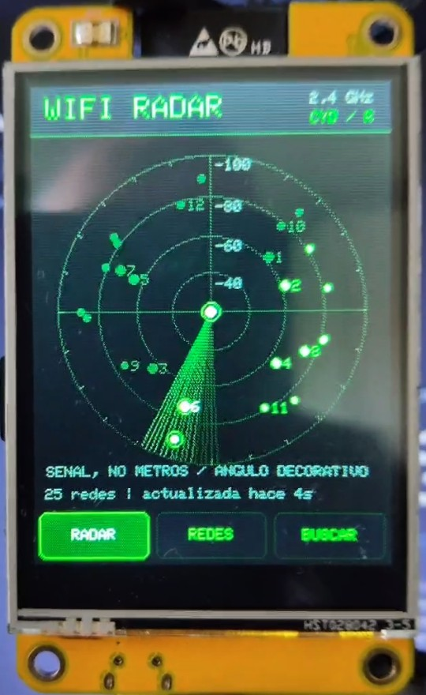
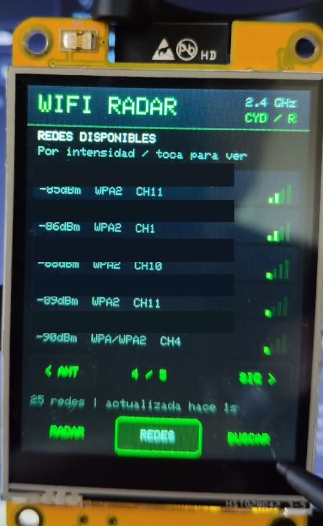
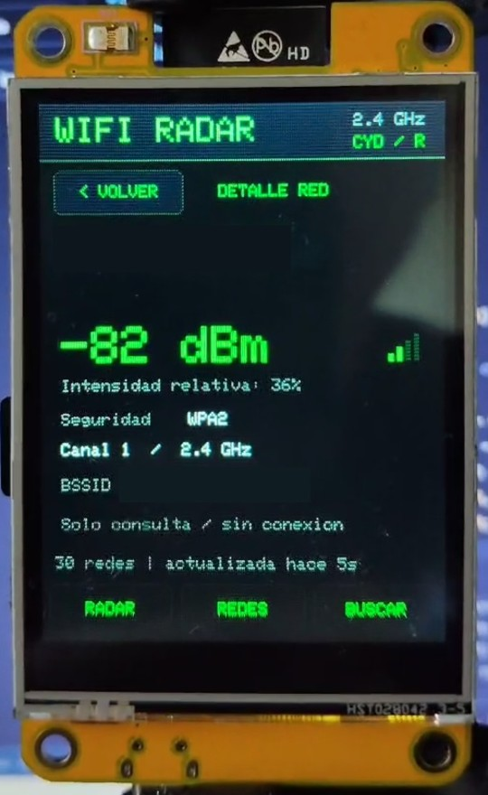
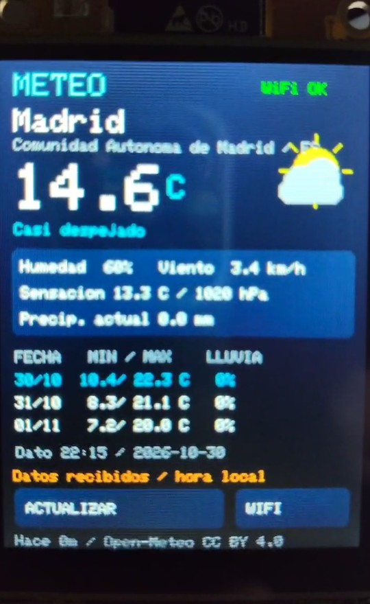
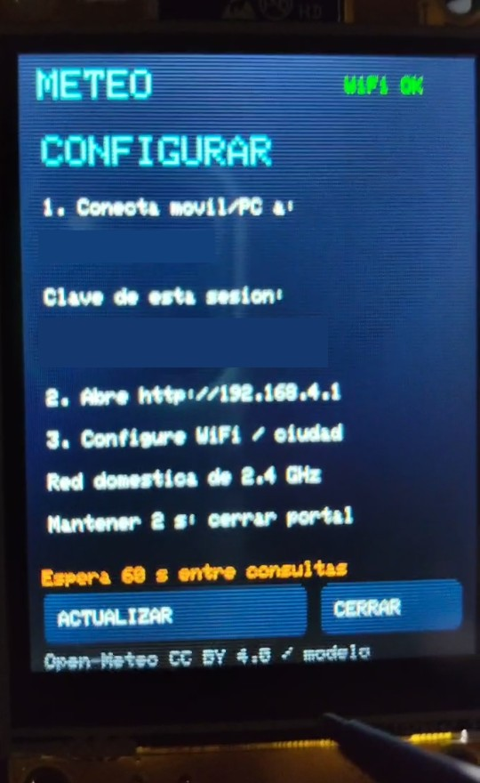
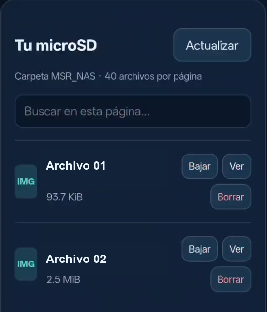
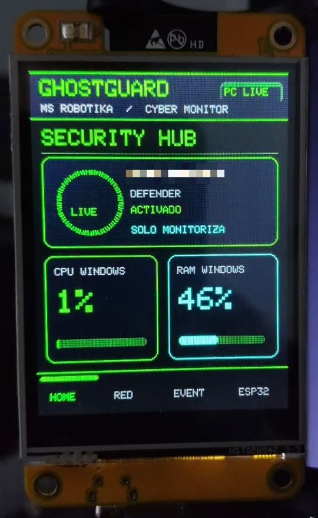
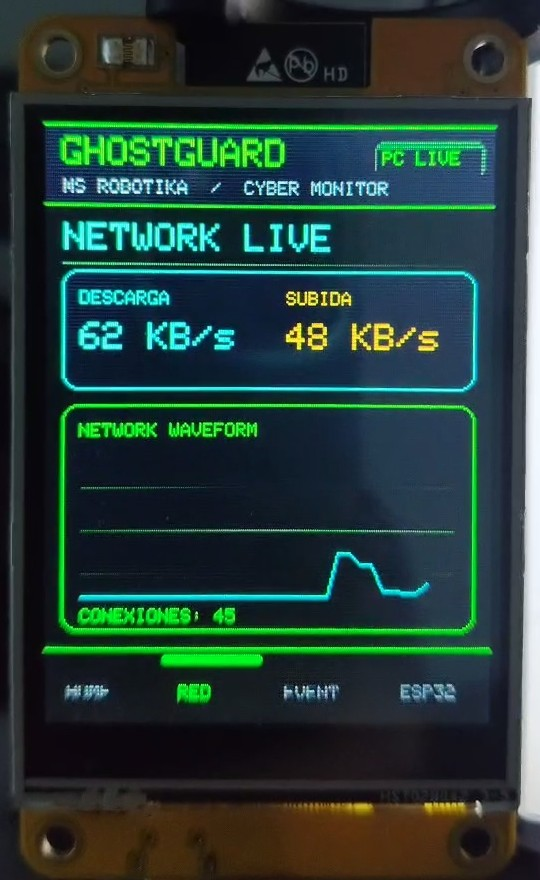
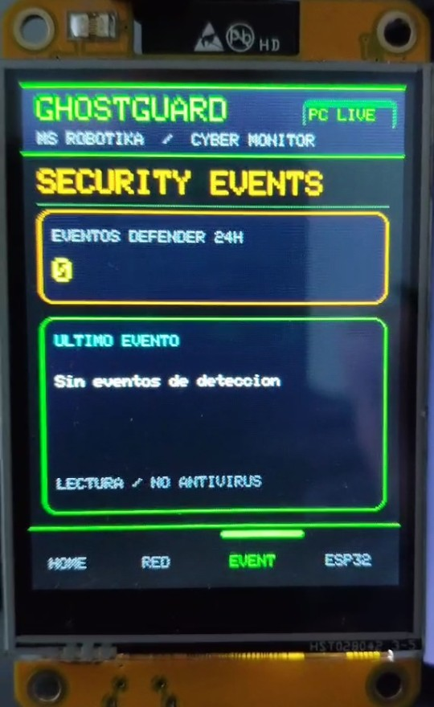
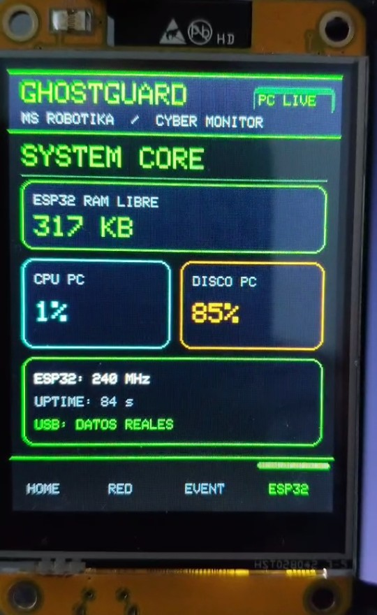

# AB MakerIDE · Proyectos
### Mira el vídeo. Descarga el proyecto. Hazlo tuyo.

Proyectos open source de **MS Robotika**, creados con **AB MakerIDE SUPER** para makers con Arduino y ESP32.

**[Conseguir el IDE](https://github.com/msrobotika/AB-MakerIDE-SUPER)** · [Instalación y descargas](https://github.com/msrobotika/AB-MakerIDE-SUPER/blob/main/docs/DESCARGAS_Y_VERSIONES.md) · [Laboratorio de pantallas](https://github.com/msrobotika/AB-Displays-Lab)

## ¿Vienes de un vídeo? Empieza aquí

### 01 · Radar WiFi CYD

Un radar naval verde en una pantalla CYD: contactos por intensidad, lista táctil de redes y detalle por punto de acceso. Se ejecuta en la placa, con WiFi de 2,4 GHz.

### **[⬇ Descargar Radar WiFi CYD en ZIP](https://raw.githubusercontent.com/msrobotika/AB-Displays-Lab/main/downloads/Radar-WiFi-CYD.zip)**

[Código y guía](https://github.com/msrobotika/AB-Displays-Lab/tree/main/examples/radar-wifi-cyd) · [Galería real](https://github.com/msrobotika/AB-Displays-Lab/blob/main/docs/GALERIA.md) · [Pines y placa](https://github.com/msrobotika/AB-Displays-Lab/tree/main/examples/radar-wifi-cyd#hardware-y-pines) · [SHA-256](https://github.com/msrobotika/AB-Displays-Lab/blob/main/downloads/Radar-WiFi-CYD.zip.sha256)

| Necesitas | Detalle |
|---|---|
| Placa declarada | CYD ESP32-2432S028R, ILI9341 240 × 320 y táctil XPT2046 |
| Proyecto | Arduino C++ con dos cabeceras; fuentes y documentación bajo MIT |
| Preparación | Extraer ZIP, abrir `RadarWiFiCYD.ino` y preparar núcleo/bibliotecas |
| Evidencia | Compilación completa y vídeo aportado del LCD físico; límites documentados |

El radio representa señal relativa; el ángulo es decorativo. No mide distancia ni dirección. Las capturas proceden del vídeo original y ocultan los nombres de red y BSSID ([origen y recortes](docs/images/radar-wifi-cyd/manifest.json)). [Qué se ha probado](https://github.com/msrobotika/AB-Displays-Lab/blob/main/docs/EVIDENCIA.md).

## 02 · Estación meteorológica WiFi CYD

Temperatura, humedad, viento, presión y previsión de tres días en una pantalla táctil. Configuración desde el navegador y datos Open-Meteo por Internet, **sin sensores externos**.

**[⬇ Descargar estación meteorológica en ZIP](https://raw.githubusercontent.com/msrobotika/AB-Displays-Lab/main/downloads/Estacion-Meteo-CYD.zip)**

[Código y guía](https://github.com/msrobotika/AB-Displays-Lab/tree/main/examples/weather-station-cyd) · [Galería y prueba con Madrid](https://github.com/msrobotika/AB-Displays-Lab/blob/main/docs/WEATHER_STATION.md) · [SHA-256](https://github.com/msrobotika/AB-Displays-Lab/blob/main/downloads/Estacion-Meteo-CYD.zip.sha256)

Placa declarada: CYD ESP32-2432S028R, ILI9341 y XPT2046. **Evidencia:** fotografía y vídeo con datos recibidos, compilación completa y dos pruebas de contrato desde PC. Madrid es un ejemplo; consulta límites y condiciones de la API en la guía. En la captura de configuración se ocultan el nombre del punto de acceso y la clave de sesión ([origen y recortes](docs/images/weather-station-cyd/manifest.json)).

## 03 · Mini NAS CYD

**Del móvil a tu microSD, sin Internet.** Convierte la CYD en un servidor local de archivos: subidas desde el navegador, lista, descarga y vista previa. Conecta mediante dos QR y conserva tus archivos en tu tarjeta.

**[⬇ Descargar Mini NAS CYD en ZIP](downloads/Mini-NAS-CYD.zip)**

[Código y guía](examples/mini-nas-cyd/) · [Vídeo editado · 30 s](docs/media/Mini-NAS-CYD-TikTok.mp4) · [Galería y pruebas](docs/MINI_NAS.md) · [SHA-256](downloads/Mini-NAS-CYD.zip.sha256)

CYD ESP32-2432S028R y microSD FAT32. **Comprobado:** carga real, seis ensayos de escritura/lectura en SD y subida/listado desde móvil confirmados por el autor. Se corrigió una escritura intermitente usando SD a 1 MHz. Es un servidor HTTP local, sin SMB/RAID ni acceso remoto por Internet. [Límites y evidencia](docs/MINI_NAS.md).

## 04 · GhostGuard CYD v1.4 · Cyber Green

**Tu PC, monitorizado desde una CYD física.** Panel táctil verde de telemetría de Windows por USB serie, con vistas HOME, RED, EVENTOS y ESP32.

**[⬇ Descargar GhostGuard v1.4 completo en ZIP](downloads/GhostGuard_CYD_v1_4_LISTO_PARA_GITHUB.zip)**

[Código y guía](examples/ghostguard-cyd/) · [Notas de versiones](examples/ghostguard-cyd/NOTAS_VERSIONES.md) · [SHA-256](downloads/GhostGuard_CYD_v1_4_LISTO_PARA_GITHUB.zip.sha256)

**Evidencia:** capturas de un vídeo físico del autor (1 nov 2026) con la CYD recibiendo datos reales del PC en las cuatro pantallas. Nombre del PC oculto. GhostGuard muestra información de Windows y Microsoft Defender, pero **no es un antivirus ni bloquea ataques**.

## De la descarga a tu placa

1. **Descarga** el ZIP del proyecto y extráelo completo.
2. **Abre** el `.ino` principal de la carpeta del proyecto (`RadarWiFiCYD.ino`, `WeatherStationCYD.ino`, `MiniNasCYD.ino` o `GhostGuard_CYD.ino`) en [AB MakerIDE SUPER](https://github.com/msrobotika/AB-MakerIDE-SUPER). Conserva todas las cabeceras y carpetas del paquete; el NAS necesita también `src/ricmoo`.
3. **Prepara y compila** con el núcleo y bibliotecas de la guía incluida. Confirma el modelo y revisión de tu placa antes de cargar.
4. **Explora y comparte** tus cambios. Oculta nombres de redes y BSSID al grabar tus propias capturas.

La descarga contiene código fuente; Arduino CLI, núcleos y bibliotecas se instalan por separado. [Guía de uso](docs/EMPEZAR.md).

## Tres sitios, un recorrido

| Buscas | Abre |
|---|---|
| Crear, editar y compilar tus proyectos | [AB MakerIDE SUPER](https://github.com/msrobotika/AB-MakerIDE-SUPER) |
| Elegir un proyecto y descargarlo | **Este catálogo** |
| Fuentes, pantallas, pines y evidencias CYD | [AB Displays Lab](https://github.com/msrobotika/AB-Displays-Lab) |

Cada entrada enlaza a sus fuentes y descarga: radar/meteo en el laboratorio original; NAS y GhostGuard dentro de este repositorio. Por ahora hay **cuatro proyectos disponibles**. [Índice de proyectos](projects.json).

## Construyámoslo entre makers

¿Has probado otra revisión, encontrado un fallo o mejorado un proyecto? [Abre una incidencia](https://github.com/msrobotika/AB-MakerIDE-Projects/issues) o consulta [cómo contribuir](CONTRIBUTING.md). Indica qué has probado y con qué placa. No compartas claves ni datos privados.

[MIT](LICENSE) para contenido propio · [Dependencias y atribuciones](THIRD_PARTY_NOTICES.md). Sin promesas de compatibilidad universal ni pruebas físicas que no se hayan realizado.
