

# AB MakerIDE · Proyectos
### Mira el vídeo. Descarga el proyecto. Hazlo tuyo.

Proyectos open source de **MS Robotika**, creados con **AB MakerIDE SUPER** para makers con Arduino y ESP32.

**[Conseguir el IDE](https://github.com/msrobotika/AB-MakerIDE-SUPER)** · [Instalación y descargas](https://github.com/msrobotika/AB-MakerIDE-SUPER/blob/main/docs/DESCARGAS_Y_VERSIONES.md) · **[Vídeos en TikTok @ms_robotika](https://www.tiktok.com/@ms_robotika)**

¿Has hecho algo con estos proyectos? Enséñalo con **#ABMakerIDE** o abre una incidencia con tu versión.

**¿Te falta la placa?** Todos los proyectos usan la **CYD ESP32-2432S028R** (pantalla táctil de 2,8"). [La que uso yo, en Amazon.es](https://www.amazon.es/dp/B0CG2WQGP9?tag=msrobotika-21). Sirve cualquier CYD con ese modelo y pantalla ILI9341; las versiones ESP32-S3 o con pantalla IPS son placas distintas y necesitan cambios.

Como Afiliado de Amazon, obtengo ingresos por las compras adscritas que cumplen los requisitos aplicables.

## ¿Vienes de un vídeo? Empieza aquí

### 01 · Radar WiFi CYD

Un radar naval verde en una pantalla CYD: contactos por intensidad, lista táctil de redes y detalle por punto de acceso. Se ejecuta en la placa, con WiFi de 2,4 GHz.

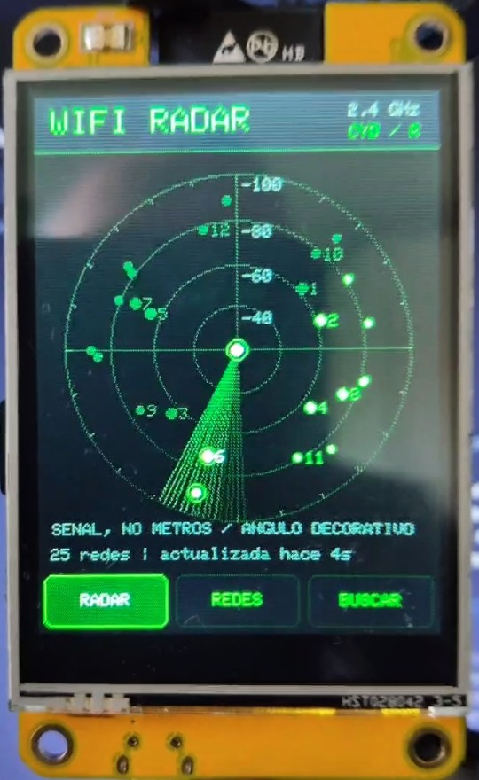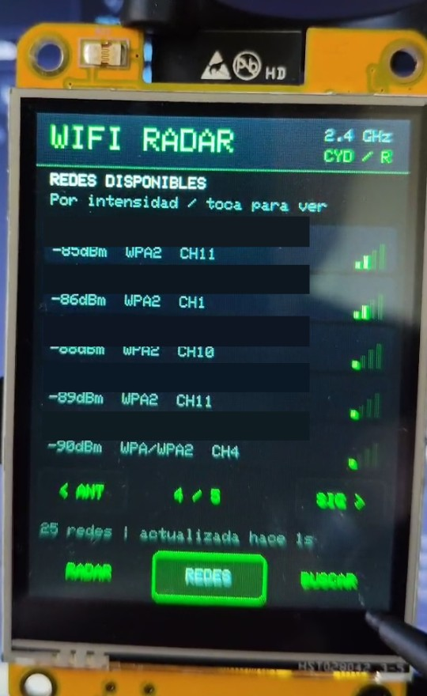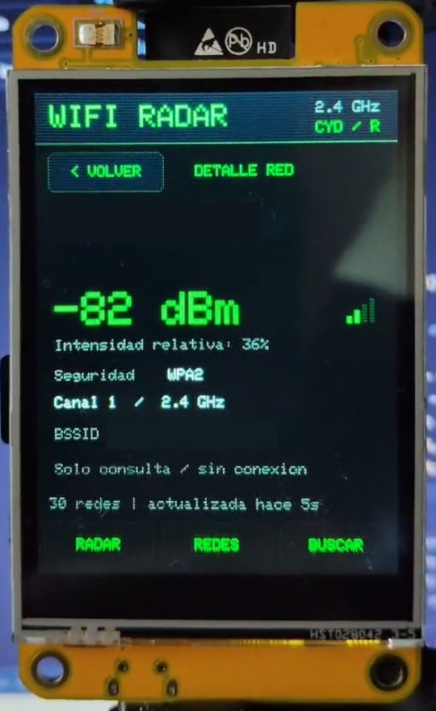

### **[⬇ Descargar Radar WiFi CYD en ZIP](downloads/Radar-WiFi-CYD.zip)**

[Código y guía](examples/radar-wifi-cyd/) · [Galería real](docs/GALERIA.md) · [Pines y placa](examples/radar-wifi-cyd/README.md#hardware-y-pines) · [SHA-256](downloads/Radar-WiFi-CYD.zip.sha256)

| Necesitas | Detalle |
|---|---|
| Placa declarada | CYD ESP32-2432S028R, ILI9341 240 × 320 y táctil XPT2046 |
| Proyecto | Arduino C++ con dos cabeceras; fuentes y documentación bajo MIT |
| Preparación | Extraer ZIP, abrir `RadarWiFiCYD.ino` y preparar núcleo/bibliotecas |
| Evidencia | Compilación completa y vídeo aportado del LCD físico; límites documentados |

El radio representa señal relativa; el ángulo es decorativo. No mide distancia ni dirección. Las capturas proceden del vídeo original y ocultan los nombres de red y BSSID ([origen y recortes](docs/images/radar-wifi-cyd/capturas-manifest.json)). [Qué se ha probado](docs/EVIDENCIA.md).

## 02 · Estación meteorológica WiFi CYD

Temperatura, humedad, viento, presión y previsión de tres días en una pantalla táctil. Configuración desde el navegador y datos Open-Meteo por Internet, **sin sensores externos**.

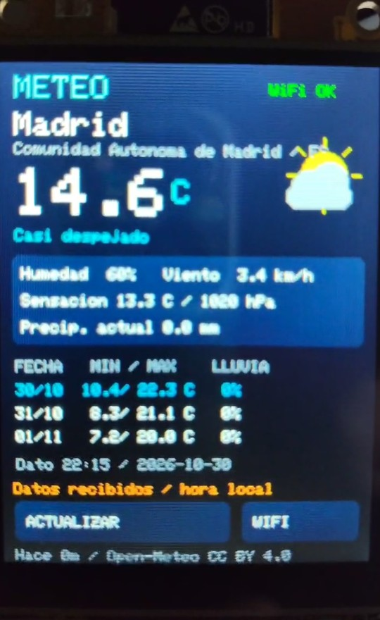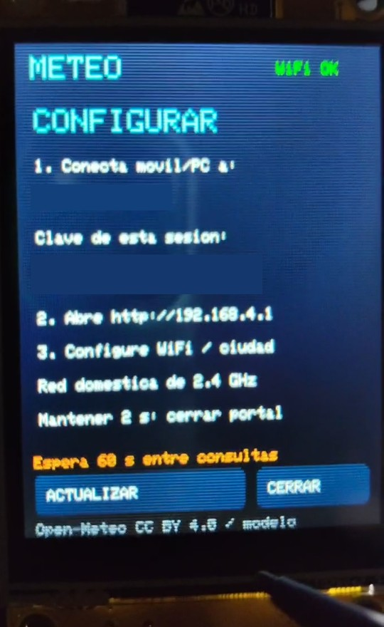

**[⬇ Descargar estación meteorológica en ZIP](downloads/Estacion-Meteo-CYD.zip)**

[Código y guía](examples/weather-station-cyd/) · [Galería y prueba con Madrid](docs/WEATHER_STATION.md) · [SHA-256](downloads/Estacion-Meteo-CYD.zip.sha256)

Placa declarada: CYD ESP32-2432S028R, ILI9341 y XPT2046. **Evidencia:** fotografía y vídeo con datos recibidos, compilación completa y dos pruebas de contrato desde PC. Madrid es un ejemplo; consulta límites y condiciones de la API en la guía. En la captura de configuración se ocultan el nombre del punto de acceso y la clave de sesión ([origen y recortes](docs/images/weather-station-cyd/capturas-manifest.json)).

## 03 · Mini NAS CYD

**Del móvil a tu microSD, sin Internet.** Convierte la CYD en un servidor local de archivos: subidas desde el navegador, lista, descarga y vista previa. Conecta mediante dos QR y conserva tus archivos en tu tarjeta.

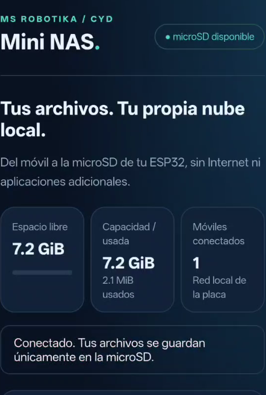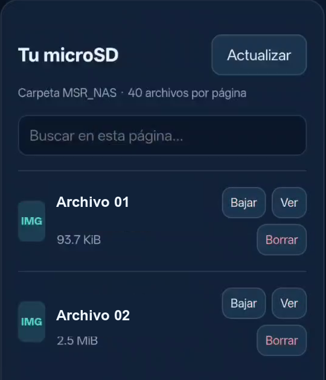

**[⬇ Descargar Mini NAS CYD en ZIP](downloads/Mini-NAS-CYD.zip)**

[Código y guía](examples/mini-nas-cyd/) · [Vídeo editado · 30 s](docs/media/Mini-NAS-CYD-TikTok.mp4) · [Galería y pruebas](docs/MINI_NAS.md) · [SHA-256](downloads/Mini-NAS-CYD.zip.sha256)

CYD ESP32-2432S028R y microSD FAT32. **Comprobado:** carga real, seis ensayos de escritura/lectura en SD y subida/listado desde móvil confirmados por el autor. Se corrigió una escritura intermitente usando SD a 1 MHz. Es un servidor HTTP local, sin SMB/RAID ni acceso remoto por Internet. [Límites y evidencia](docs/MINI_NAS.md).

## 04 · GhostGuard CYD v1.4 · Cyber Green

**Tu PC, monitorizado desde una CYD física.** Panel táctil verde de telemetría de Windows por USB serie, con vistas HOME, RED, EVENTOS y ESP32.

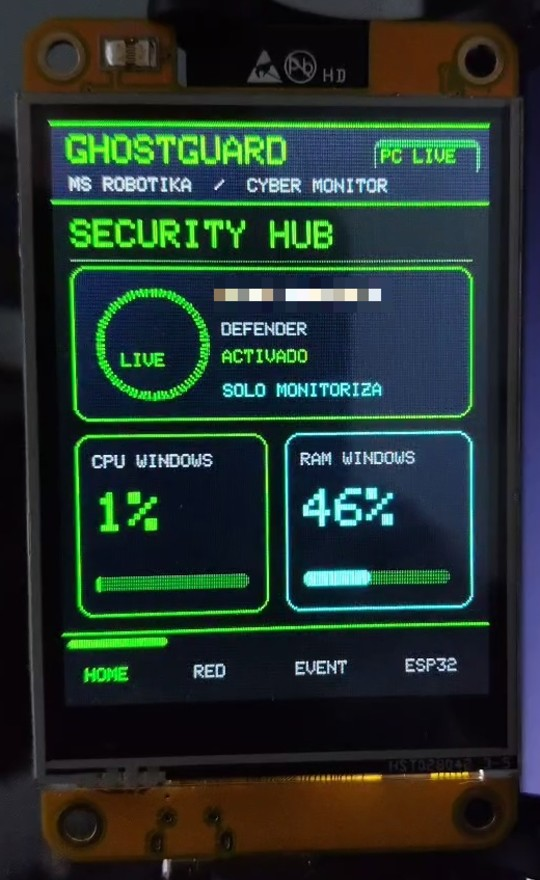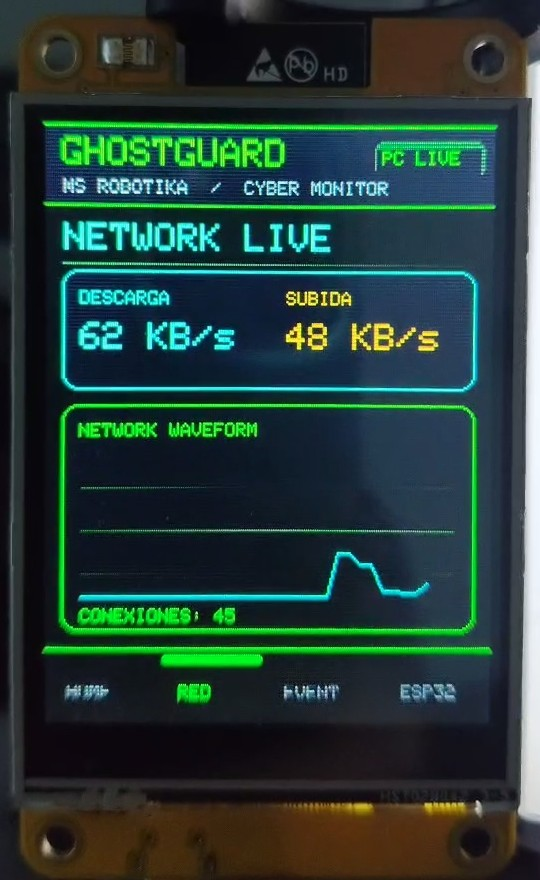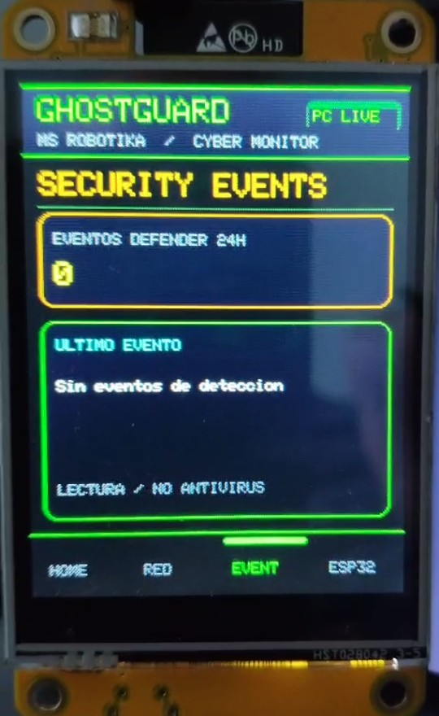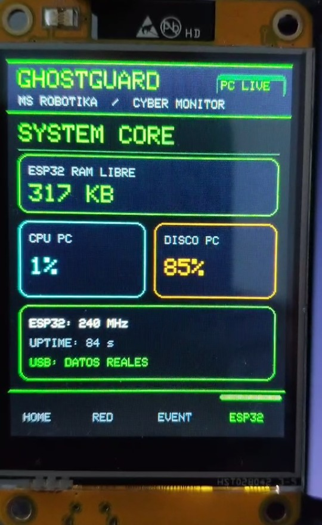

**[⬇ Descargar GhostGuard v1.4 completo en ZIP](downloads/GhostGuard_CYD_v1_4_LISTO_PARA_GITHUB.zip)**

[Código y guía](examples/ghostguard-cyd/) · [Vídeo editado · 27 s](docs/media/GhostGuard-CYD-TikTok.mp4) · [Notas de versiones](examples/ghostguard-cyd/NOTAS_VERSIONES.md) · [SHA-256](downloads/GhostGuard_CYD_v1_4_LISTO_PARA_GITHUB.zip.sha256)

**Evidencia:** capturas de un vídeo físico del autor (1 nov 2026) con la CYD recibiendo datos reales del PC en las cuatro pantallas. Nombre del PC oculto. GhostGuard muestra información de Windows y Microsoft Defender, pero **no es un antivirus ni bloquea ataques**.

## 05 · Reflejos MS · juego original

**¿Qué tan rápido eres?** Se enciende un chip en la pantalla de la CYD y tienes que tocarlo antes de que se vacíe la barra. Cada acierto acelera el ritmo y el LED RGB de la placa te dice si has acertado.

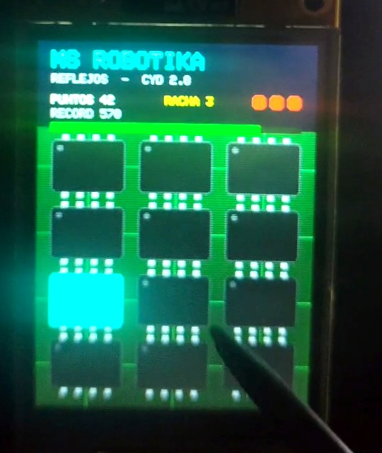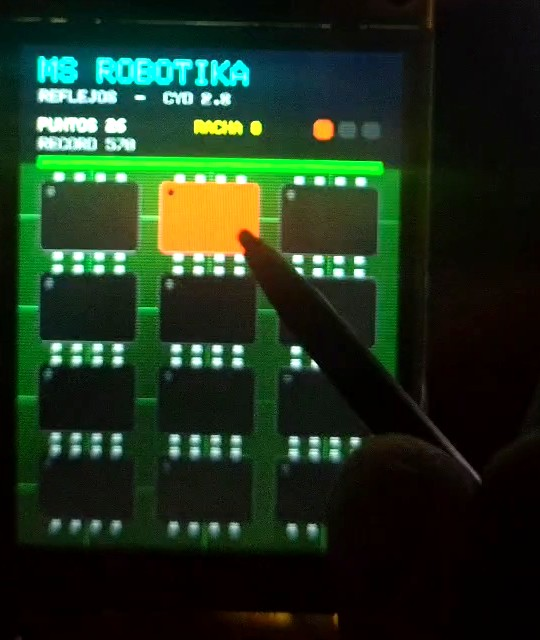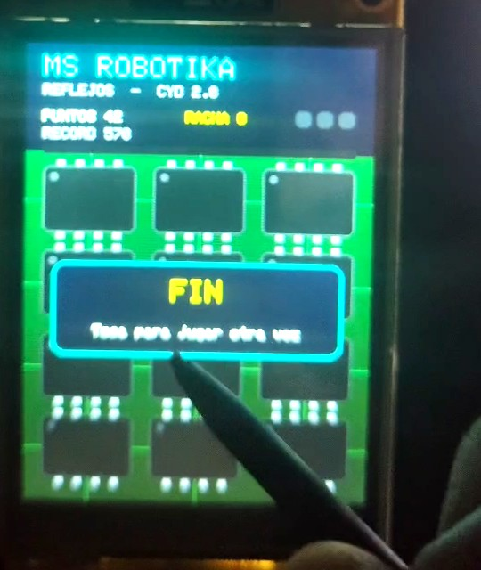

**[⬇ Descargar Reflejos MS en ZIP](downloads/Reflejos-MS-CYD.zip)**

[Código y guía](examples/reflejos-ms-cyd/) · [Vídeo editado · 17 s](docs/media/Reflejos-MS-TikTok.mp4) · [SHA-256](downloads/Reflejos-MS-CYD.zip.sha256) · [Contenido y hashes](downloads/reflejos-manifest.json)

Juego original de MS Robotika, sin Wi-Fi ni microSD. **Comprobado:** compilación, carga verificada en una CYD real y pantalla y táctil confirmados por el autor (1 nov 2026).

## 06 · Kilovatio MS · precio de la luz

**¿Pongo ya la lavadora?** La CYD descarga el precio de la luz (PVPC) hora a hora desde Red Eléctrica y te lo dice con colores: ahora, gráfica del día, la mejor hora para cada electrodoméstico y los precios de mañana. Cinco pantallas que se cambian deslizando, y el LED de la placa en verde, amarillo o rojo.

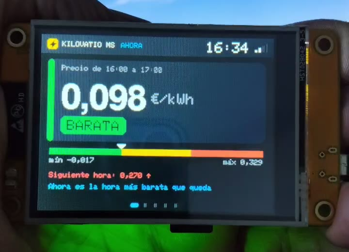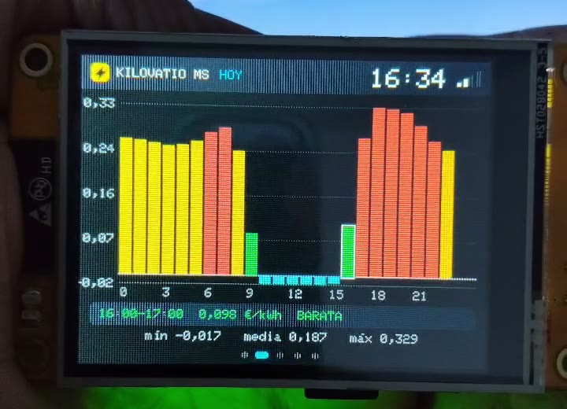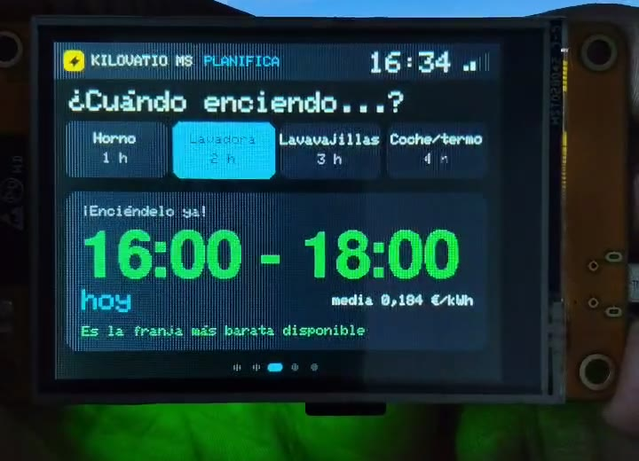

**[⬇ Descargar Kilovatio MS en ZIP](downloads/Kilovatio-MS-CYD.zip)**

[Código y guía](examples/kilovatio-ms-cyd/) · [Vídeo editado · 26 s](docs/media/Kilovatio-MS-TikTok.mp4) · [Capturas reales](docs/images/kilovatio-ms-cyd/) · [SHA-256](downloads/Kilovatio-MS-CYD.zip.sha256) · [Contenido y hashes](downloads/kilovatio-manifest.json)

Proyecto original de MS Robotika. Wi-Fi desde el móvil con un QR y datos de la API pública de REE, sin cuenta. Precio orientativo sin impuestos: compara horas, no sustituye a tu factura. **Comprobado:** compilación, carga verificada y Wi-Fi, descarga de precios y las cinco pantallas confirmadas en una CYD real (2 nov 2026).

## 07 · MacroPad MS · panel de atajos

**Tu PC, a toques.** Seis botones grandes por página para la música, Teams y Zoom, copiar y pegar, bloquear el PC o cambiar de escena en OBS. Se conecta como teclado Bluetooth o por USB con un pequeño programa para Windows. Sin Wi-Fi.

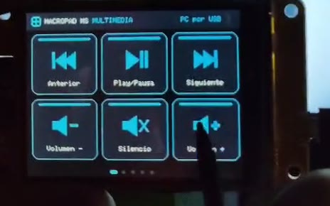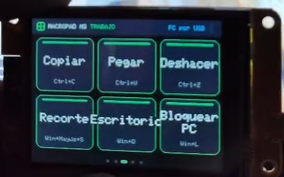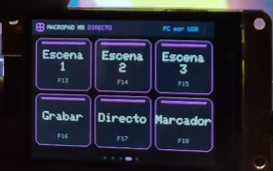

**[⬇ Descargar MacroPad MS en ZIP](downloads/MacroPad-MS-CYD.zip)**

[Código y guía](examples/macropad-ms-cyd/) · [Vídeo editado · 35 s](docs/media/MacroPad-MS-TikTok.mp4) · [Capturas reales](docs/images/macropad-ms-cyd/) · [SHA-256](downloads/MacroPad-MS-CYD.zip.sha256) · [Contenido y hashes](downloads/macropad-manifest.json)

Proyecto original de MS Robotika. **Comprobado:** compilación, carga verificada y modo USB en Windows con 205 atajos enviados desde una CYD real (2 nov 2026). El emparejamiento Bluetooth está pendiente de probar en hardware real.

## 08 · Vigía MS · detector de rastreadores

**¿Llevas un AirTag escondido sin saberlo?** La CYD escucha el Bluetooth de alrededor y reconoce rastreadores de Apple, Samsung, Tile y Google. Si uno que no está con su dueño te acompaña varios minutos, avisa en rojo y te guía con pitidos «frío / caliente» hasta encontrarlo. Sin Wi-Fi ni móvil.

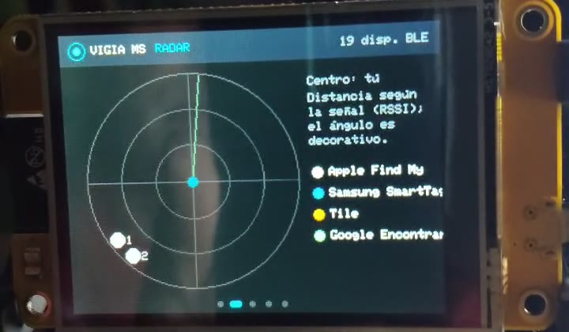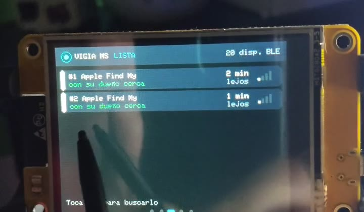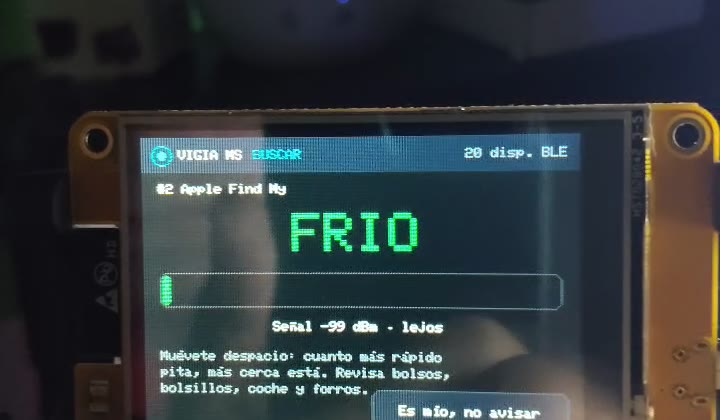

**[⬇ Descargar Vigía MS en ZIP](downloads/Vigia-MS-CYD.zip)**

[Código y guía](examples/vigia-ms-cyd/) · [Vídeo editado · 22 s](docs/media/Vigia-MS-TikTok.mp4) · [Capturas reales](docs/images/vigia-ms-cyd/) · [SHA-256](downloads/Vigia-MS-CYD.zip.sha256) · [Contenido y hashes](downloads/vigia-manifest.json)

Proyecto original de MS Robotika. Escucha pasiva: no se conecta a nada y no muestra direcciones. No detecta todos los rastreadores ni sustituye a las alertas del móvil; si te sientes en peligro, llama al 112. **Comprobado:** compilación, carga verificada y detección de dispositivos Apple Find My reales en una CYD (2 nov 2026). La alarma por un rastreador lejos de su dueño está pendiente de comprobar.

## 09 · Radar Aviones MS · aviones en directo

**¿Qué avión pasa por encima de tu casa?** Un radar con barrido muestra en directo los aviones que vuelan a menos de 46 km, y al tocar uno ves su vuelo, modelo, altura, velocidad, distancia y rumbo. Datos ADS-B gratuitos de adsb.lol, sin cuenta ni claves. La pantalla nunca muestra tu ubicación.

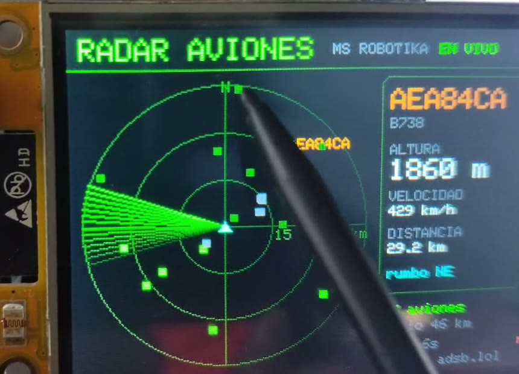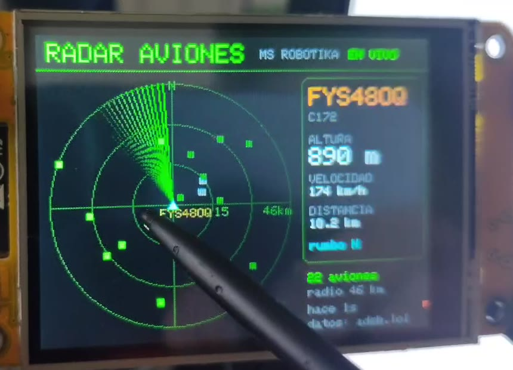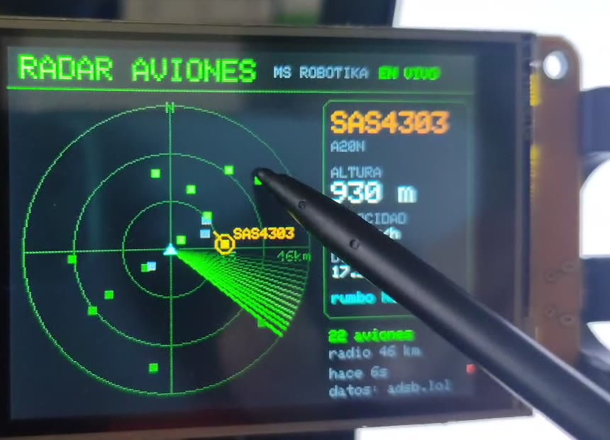

**[⬇ Descargar Radar Aviones MS en ZIP](downloads/Radar-Aviones-MS-CYD.zip)**

[Código y guía](examples/radar-aviones-ms-cyd/) · [Vídeo editado · 27 s](docs/media/Radar-Aviones-MS-TikTok.mp4) · [Capturas reales](docs/images/radar-aviones-ms-cyd/) · [SHA-256](downloads/Radar-Aviones-MS-CYD.zip.sha256) · [Contenido y hashes](downloads/radar-aviones-manifest.json)

Proyecto original de MS Robotika. Posiciones aproximadas con unos segundos de retraso: no sirve para navegación. **Comprobado:** compilación, carga verificada, autoprueba de la geometría y descarga de 32-35 aviones reales alrededor de Madrid en una CYD (3 nov 2026).

## 10 · Reloj Despertador MS · el proyecto del tutorial

**Un reloj despertador con Wi-Fi que se pone en hora solo.** Hora en dígitos de 7 segmentos, fecha en español, cambio de hora automático y una alarma que ajustas tocando la pantalla o desde el monitor serie, con «posponer 5 min». Es el proyecto del tutorial en vídeo de AB MakerIDE: crear el proyecto, elegir la placa, librerías, compilar, grabar y monitor serie.

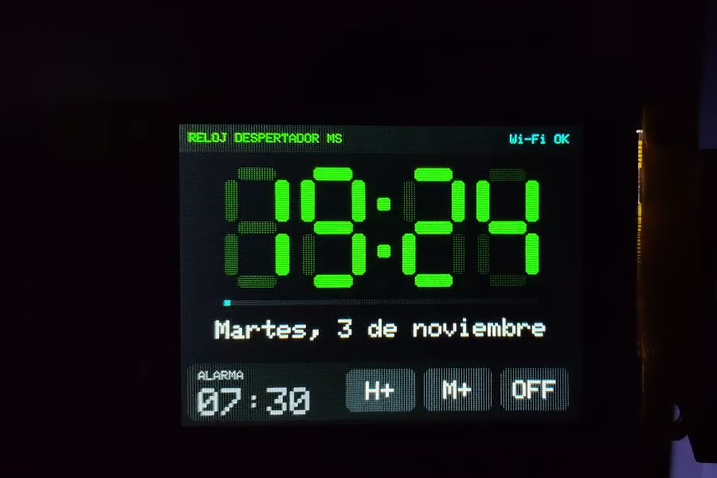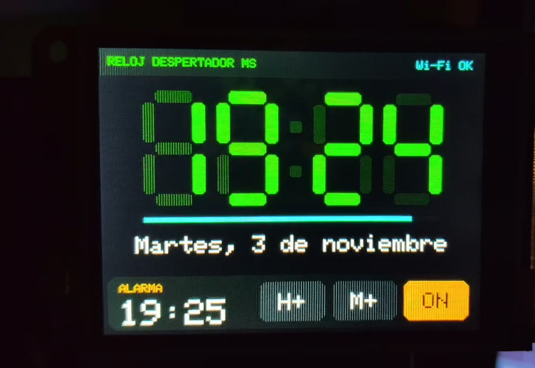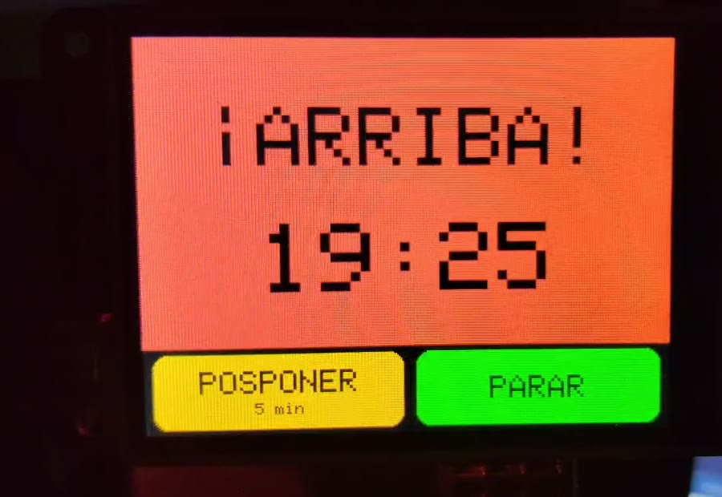

**[⬇ Descargar Reloj Despertador MS en ZIP](downloads/Reloj-Despertador-MS-CYD.zip)**

[Código y guía](examples/reloj-despertador-ms-cyd/) · [Vídeo editado · 33 s](docs/media/Reloj-Despertador-MS-TikTok.mp4) · [Capturas reales](docs/images/reloj-despertador-ms-cyd/) · [SHA-256](downloads/Reloj-Despertador-MS-CYD.zip.sha256) · [Contenido y hashes](downloads/reloj-despertador-manifest.json)

Proyecto original de MS Robotika. Sin batería: si se va la luz, la alarma no suena; no lo uses para avisos importantes. **Comprobado:** compilación, carga verificada desde AB MakerIDE, autoprueba, hora por internet y alarma que suena y se para por el monitor serie en una CYD (3 nov 2026). Los botones táctiles están pendientes de comprobar en la placa.

## De la descarga a tu placa

1. **Descarga** el ZIP del proyecto y extráelo completo.
2. **Abre** el `.ino` principal de la carpeta del proyecto (`RadarWiFiCYD.ino`, `WeatherStationCYD.ino`, `MiniNasCYD.ino`, `GhostGuard_CYD.ino`, `ReflejosMS.ino`, `KilovatioMS.ino`, `MacroPadMS.ino`, `VigiaMS.ino`, `RadarAvionesMS.ino` o `RelojDespertadorMS.ino`) en [AB MakerIDE SUPER](https://github.com/msrobotika/AB-MakerIDE-SUPER). Conserva todas las cabeceras y carpetas del paquete; el NAS necesita también `src/ricmoo`.
3. **Prepara y compila** con el núcleo y bibliotecas de la guía incluida. Confirma el modelo y revisión de tu placa antes de cargar.
4. **Explora y comparte** tus cambios. Oculta nombres de redes y BSSID al grabar tus propias capturas.

La descarga contiene código fuente; Arduino CLI, núcleos y bibliotecas se instalan por separado. [Guía de uso](docs/EMPEZAR.md).

## Dos sitios, un recorrido

| Buscas | Abre |
|---|---|
| Crear, editar y compilar tus proyectos | [AB MakerIDE SUPER](https://github.com/msrobotika/AB-MakerIDE-SUPER) |
| Elegir un proyecto, descargarlo y ver fuentes, pines y evidencias | **Este catálogo** |

Las fuentes, descargas y evidencias de los proyectos están dentro de este repositorio. Por ahora hay **diez proyectos disponibles**. [Índice de proyectos](projects.json).

## Construyámoslo entre makers

¿Has probado otra revisión, encontrado un fallo o mejorado un proyecto? [Abre una incidencia](https://github.com/msrobotika/AB-MakerIDE-Projects/issues) o consulta [cómo contribuir](CONTRIBUTING.md). Indica qué has probado y con qué placa. No compartas claves ni datos privados.

[MIT](LICENSE) para contenido propio · [Dependencias y atribuciones](THIRD_PARTY_NOTICES.md). Sin promesas de compatibilidad universal ni pruebas físicas que no se hayan realizado.
