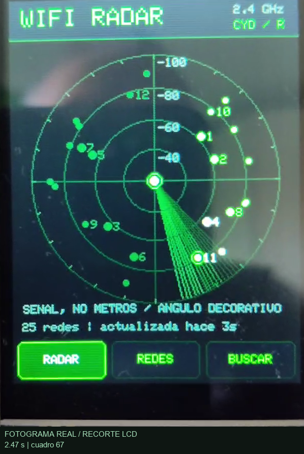
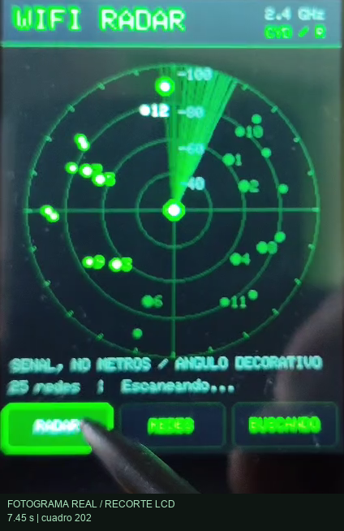
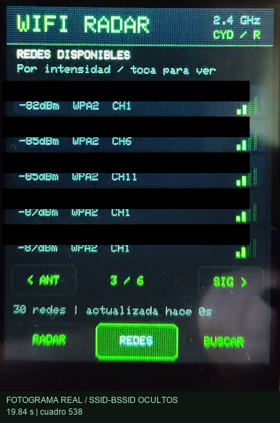
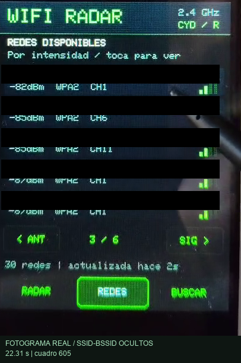
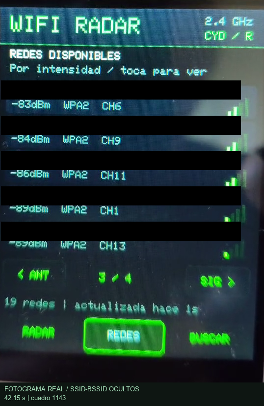
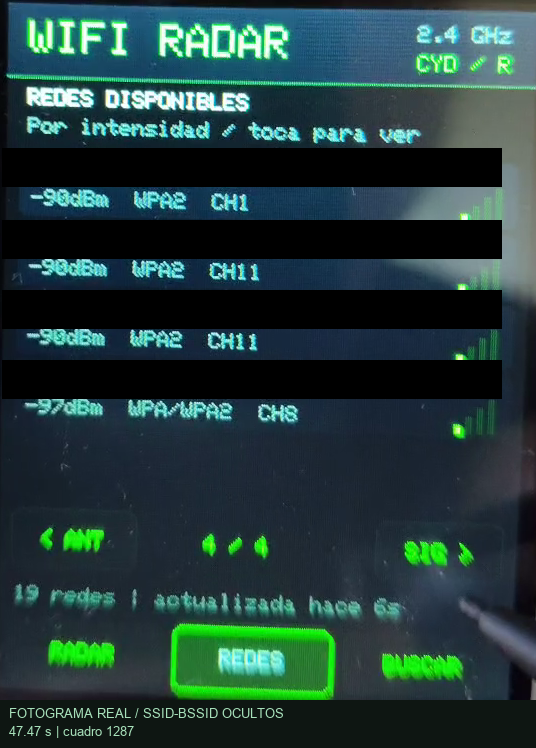

# Galería · Radar WiFi CYD

[← Catálogo](../README.md) · [Proyecto](../examples/radar-wifi-cyd/) · [Manifiesto](images/radar-wifi-cyd/manifest.json)

Ocho fotogramas reales del vídeo aportado, extraídos de nuevo. Recorte del LCD, máscaras opacas sobre SSID/BSSID y leyenda añadida fuera de la imagen. Sin generación por IA. Los tiempos son estimaciones a partir del índice y FPS reportado; no son tiempos de una prueba nueva.

| Radar principal · 2.47 s | Radar con lápiz táctil · 7.45 s |
|:---:|:---:|
|  |  |

| Lista de redes · 19.84 s | Lista con lápiz táctil · 22.31 s |
|:---:|:---:|
|  |  |

| Detalle de red · 27.29 s | Radar con barrido · 37.21 s |
|:---:|:---:|
|  |  |

| Redes actualizadas · 42.15 s | Última página de redes · 47.47 s |
|:---:|:---:|
|  |  |

El manifiesto conserva índice de cuadro, recorte, máscaras y SHA-256 por imagen. El vídeo original y los fotogramas sin anonimizar no se suben. [Procedencia y privacidad](PROCEDENCIA_Y_PRIVACIDAD.md) · [Límites de evidencia física](EVIDENCIA.md).
