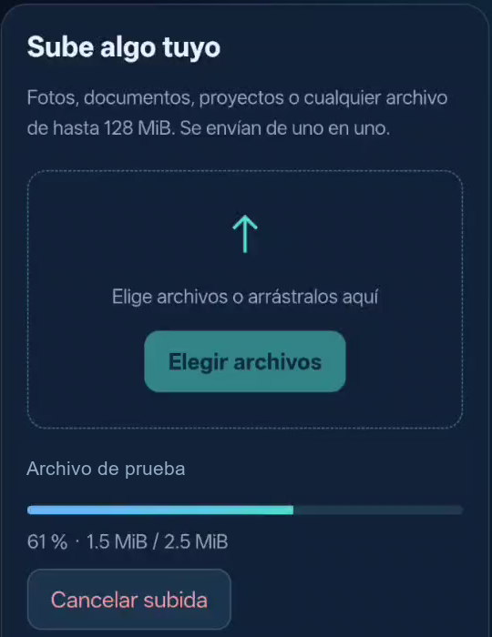
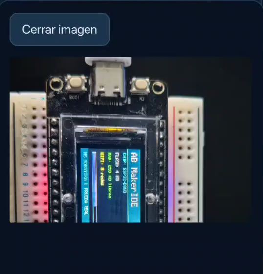

# Mini NAS CYD · galería y evidencia

[← Catálogo](../README.md) · [Código y guía](../examples/mini-nas-cyd/) · [Descargar ZIP](../downloads/Mini-NAS-CYD.zip)

Servidor local de archivos por Wi-Fi para una CYD con microSD FAT32. Es HTTP desde el navegador; no se anuncia como SMB, RAID ni nube accesible por Internet.

## Demostración desde el móvil

[Ver o descargar el vídeo editado · 30 s](media/Mini-NAS-CYD-TikTok.mp4)

El material procede del vídeo aportado por el autor el 31-10-2026. El montaje contiene cortes, fotogramas fijos revisados y un tramo acelerado ×5, identificado en pantalla. No mide la velocidad de transferencia. La música es una instrumental original sintetizada para este montaje; no incluye la pista de audio original ni grabaciones musicales de terceros. El QR final enlaza al IDE público, no al acceso privado al NAS.

| Panel web real | Subida desde el navegador |
|:---:|:---:|
|  |  |
| Lista de archivos guardados | Vista previa de un archivo de prueba |
|  |  |

Son píxeles decodificados del vídeo original, recortados y con máscaras opacas únicamente sobre nombres. La foto de una placa que aparece en la vista previa es **el contenido de un archivo de prueba**: no se presenta como una fotografía del NAS ejecutándose en esa placa. [Fotogramas, tiempos, recortes y hashes](images/mini-nas-cyd/manifest.json) · [Manifiesto del montaje](media/mini-nas-edit-manifest.json).

## Qué se ha comprobado

| Evidencia | Alcance |
|---|---|
| Compilación completa y carga del NAS corregido | Programa 1 073 298 bytes y RAM estática 50 388; carga correcta, dos comprobaciones de hash, sin borrado total ni dumps. Hash y resultados en el informe SD. |
| Pruebas reales de tarjeta | A 4 MHz se reprodujo EIO con espacio libre. A 1 MHz, seis archivos de 262 161 bytes se escribieron, cerraron, reabrieron y compararon byte a byte; se limpiaron solo los archivos de ensayo. |
| Confirmación del autor desde el móvil | Dos QR abren el panel sin teclear clave; después de corregir SD, confirmó «Sí, se guarda y aparece» al subir y comprobar el listado. |
| Vídeo original del móvil | Muestra el panel, progreso, archivos guardados y vista previa. No demuestra por sí solo todos los límites del firmware. |
| Pruebas JS y reglas C++ | Once tests JS con dobles de DOM/red; 47 aserciones de reglas y una de geometría en compilación. No son pruebas del navegador/SD por sí solas. |
| Pruebas HTTP iniciales desde PC | Correspondían a un binario anterior y autenticación Basic. No se atribuyen a la carga QR corregida. |

[Reparación SD y aceptación](../examples/mini-nas-cyd/.specify/bugs/sd-upload/test.md) · [Acceso QR](../examples/mini-nas-cyd/specs/002-qr-access/verification.md) · [Ensayo HTTP inicial](../examples/mini-nas-cyd/specs/001-mini-nas/verification.md).

No se certifican todas las tarjetas/variantes, sesiones prolongadas, cortes de alimentación o velocidades. No se ha comparado el hash de una descarga móvil de la última carga. Esta publicación conserva las pruebas realizadas; no ha vuelto a grabar hardware.

## Privacidad y datos

No se incluyen la grabación completa, menús/archivos privados del teléfono, claves Wi-Fi, QR reales de acceso, cookies, tokens, perfiles de red ni firmware compilado. Los ejemplos QR del código usan valores ficticios públicos. No publiques los QR de tu NAS: conceden acceso a la sesión.

Código propio MIT; dependencias conservan sus licencias, incluido ricmoo/QRCode MIT en src/ricmoo. Se preservan licencia y hashes de procedencia. [Guía y atribuciones del proyecto](../examples/mini-nas-cyd/THIRD_PARTY_NOTICES.md).
