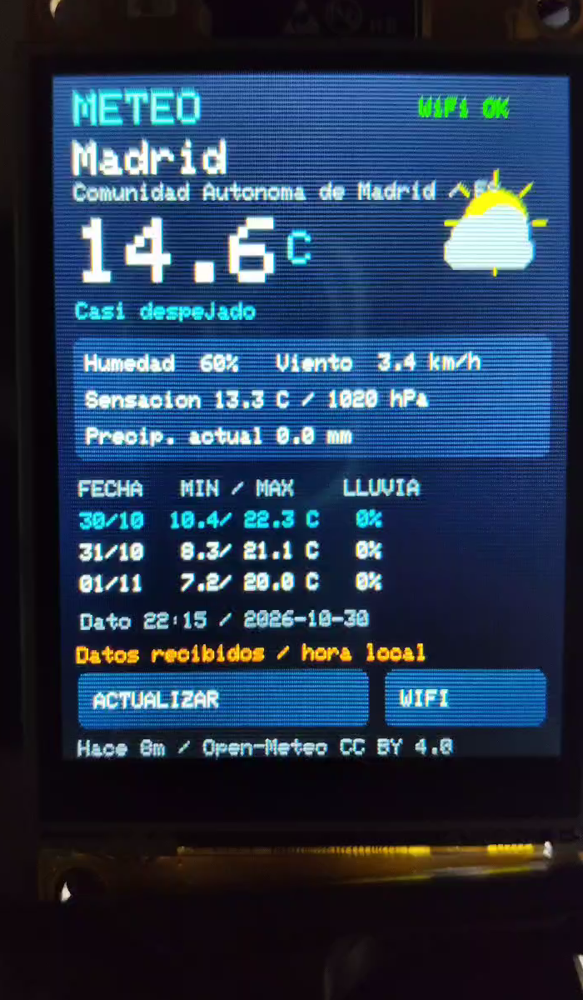
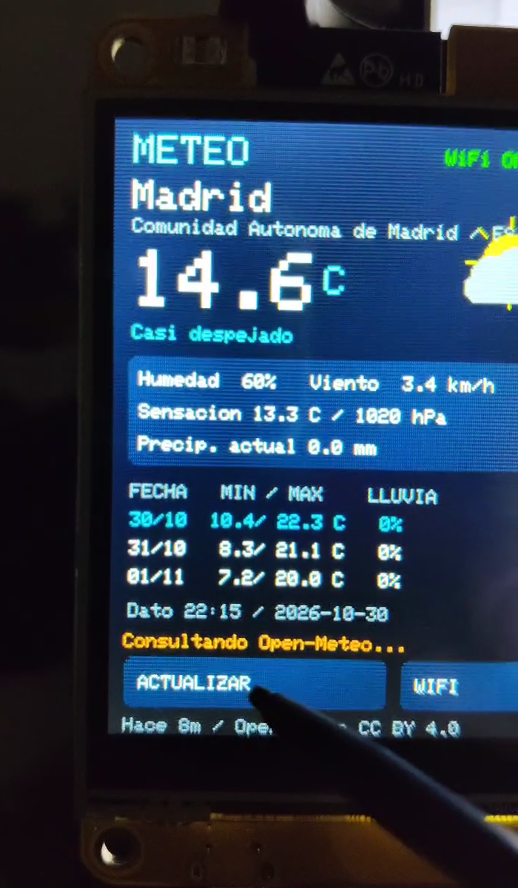
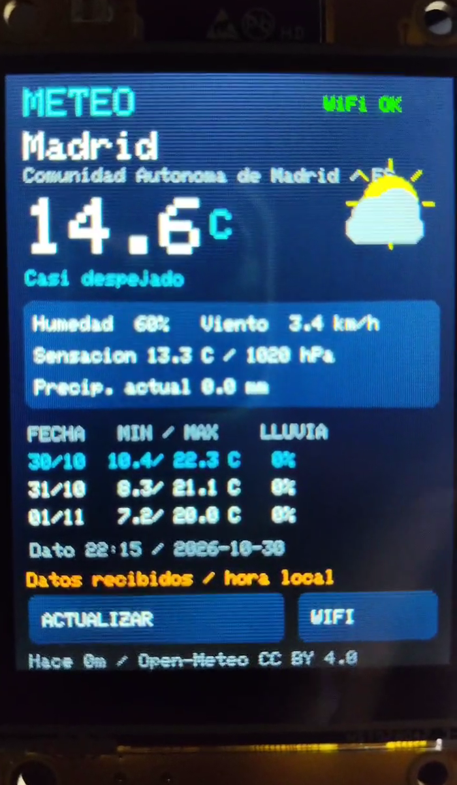
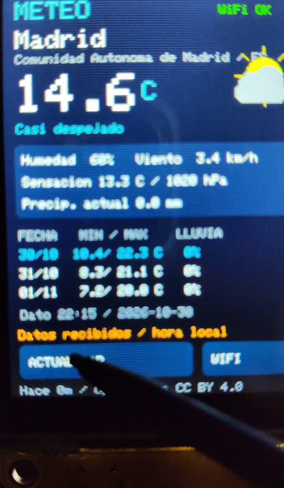
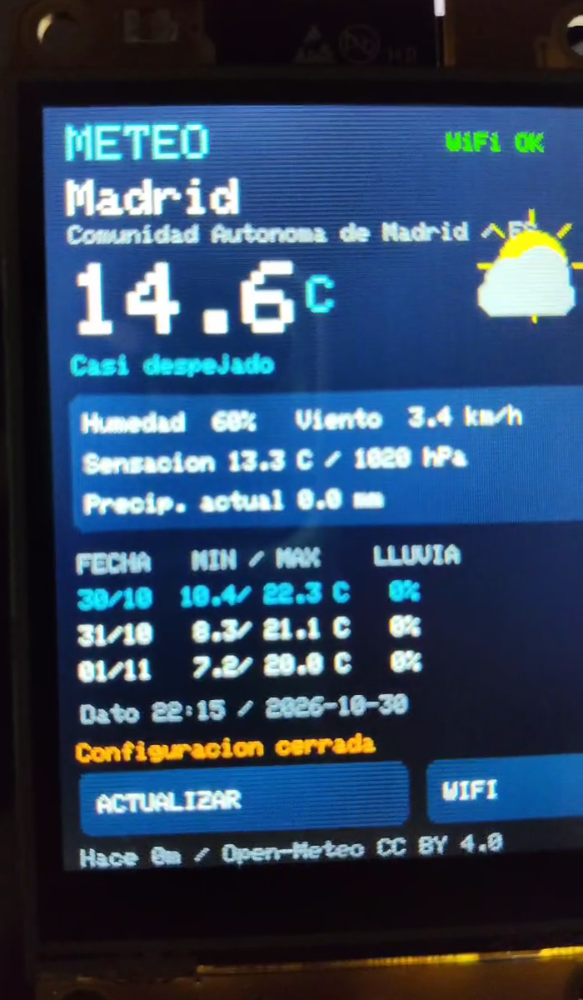

# Estación meteorológica CYD · evidencia y galería

[← Catálogo](../README.md) · [Proyecto](../examples/weather-station-cyd/) · [Descargar ZIP](../downloads/Estacion-Meteo-CYD.zip) · [Manifiesto de capturas](images/weather-station-cyd/manifest.json)

**Madrid es la ubicación de ejemplo elegida para la prueba.** La fotografía y los cinco fotogramas siguientes proceden del material aportado por el autor el 2026-10-30. No se ha recreado la pantalla ni generado datos. Son capturas históricas, no información meteorológica actual.

La nueva toma muestra **WIFI OK**, Madrid, 14,6 °C, humedad, viento, presión y previsión de tres días; conserva la atribución a Open-Meteo. Se observa el uso de ACTUALIZAR y el regreso desde configuración. Los valores son datos de modelo obtenidos por Internet, no medidas de sensores locales.

| Madrid: fotografía del LCD con datos | Datos recibidos y WIFI OK |
|:---:|:---:|
|  |  |

| Actualización desde el táctil | Vista general y previsión de tres días |
|:---:|:---:|
|  |  |

| Control táctil de actualización | Regreso a meteorología tras cerrar configuración |
|:---:|:---:|
|  |  |

## Alcance de la prueba

- Se entró en el AP de configuración usando una clave de sesión facilitada por el autor; el portal aceptó por HTTP 200 la configuración de WiFi y Madrid/ES. Se restauró la conexión habitual del PC y se eliminó el perfil temporal.
- El autor confirmó los valores en pantalla y después aportó la fotografía y vídeo que ahora permiten observarlos directamente.
- El firmware completo se compiló realmente: salida 0, 1.206.308 bytes de programa (92 %) y 52.896 bytes de RAM estática (16 %).
- Se ejecutaron dos pruebas de contrato HTTPS desde PC con la raíz del firmware: correctas. No son ejecución del parser C++ ni ensayos de radio.
- La exportación original `compiled_only` se conserva como metadato histórico. No se ha grabado firmware durante esta incorporación ni se ha demostrado el hash del binario instalado.

No se han probado exhaustivamente otras ciudades, persistencia tras reinicio, recuperación prolongada, todas las ramas de error ni rendimiento continuo. [Informe de aceptación](../specs/003-weather-station/verification.md).

## Privacidad

El tramo del vídeo que abre el portal y muestra una clave temporal se excluye de las capturas publicadas y del montaje final. No se publica la foto del router, SSID, claves, MAC, números de serie, perfiles WiFi, brutos ni copias del dispositivo. Los PNG mantienen los píxeles decodificados de su recorte y omiten metadatos del original.

## Datos y condiciones

[Open-Meteo](https://open-meteo.com/) proporciona los datos bajo CC BY 4.0. Su [API tiene condiciones propias](https://open-meteo.com/en/terms), incluidas las del servicio gratuito y las actividades comerciales/promocionales. La licencia MIT del código no cambia esas condiciones.

## Vídeo de presentación

[Ver o descargar el MP4 vertical (36 s)](media/Estacion-Meteo-CYD-TikTok.mp4) · [Portada](media/Estacion-Meteo-CYD-portada.png) · [Subtítulos SRT](media/Estacion-Meteo-CYD-subtitulos.srt). Montaje de tomas reales con recorte/estabilización de perspectiva, rótulos, voz sintética en español, música original y QR al catálogo; el sonido original no se publica.
