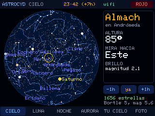
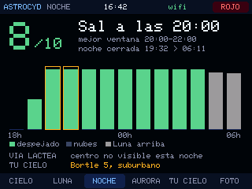

# AstroCYD MS · CYD

[← Catálogo](../../README.md) · [AB MakerIDE SUPER](https://github.com/msrobotika/AB-MakerIDE-SUPER)

Asistente de **astronomía y astrofotografía** para la **CYD ESP32-2432S028R** (ILI9341 horizontal 320 × 240 y táctil XPT2046). Un mapa del cielo en directo, la Luna, una nota de 0 a 10 para esta noche, el aviso de auroras, cuántas estrellas te roba la contaminación lumínica y un disparador por Bluetooth para el móvil. Todo con un **modo rojo** para no perder la visión nocturna.

Hecho con AB MakerIDE. Solo usa la placa: Wi-Fi, Bluetooth, pantalla, táctil y LED.

<div align="center"></div>

## Pantallas

| Pestaña | Qué enseña |
|---|---|
| **CIELO** | Todo el cielo sobre ti: 5044 estrellas, las 88 constelaciones, Mercurio, Venus, Marte, Júpiter, Saturno, la Luna con su fase y el Sol. El centro es el cénit, el borde el horizonte, el norte arriba y el este a la izquierda, como al mirar hacia arriba. Toca un objeto para ver su nombre, su altura, hacia dónde mirar y su brillo. **−1h / ya / +1h** adelanta o atrasa el cielo hasta 12 h. |
| **LUNA** | Fase dibujada tal como se ve, porcentaje iluminado, hora y dirección de salida y puesta, altura, distancia y días hasta la próxima luna nueva y llena. |
| **NOCHE** | Nota de 0 a 10 para esta noche y la mejor ventana de 2 horas. Mezcla las nubes hora a hora, la Luna (fase y altura), la noche astronómica (Sol 18° bajo el horizonte) y tu contaminación lumínica. Dice también si el centro de la Vía Láctea sube por encima de 10°. |
| **AURORA** | Índice Kp actual, máximo previsto para hoy, mañana y pasado, y el Kp que haría falta para ver auroras desde tu latitud geomagnética. Si se alcanza, el LED se pone rojo. |
| **TU CIELO** | Dos cielos lado a lado: uno oscuro y el tuyo según tu clase Bortle, con cuántas estrellas del catálogo hay sobre el horizonte en cada uno. **− / +** prueba otras clases («¿y si me voy al campo?»). |
| **FOTO** | Intervalómetro: la placa se empareja con el móvil como un botón de «subir volumen» y dispara cada X segundos, las fotos que pidas y con retardo inicial. **FOTO YA** dispara una sola. |

El botón **ROJO** de arriba pasa todo a rojo y baja el brillo. Tocar la hora vuelve al momento actual.

## Primera puesta en marcha

1. Si la placa ya tenía Radar Aviones MS o Kilovatio MS, reutiliza su calibración del táctil, su Wi-Fi y su ubicación. Si no, toca el centro de las tres cruces para calibrar.
2. Sin Wi-Fi guardada, la placa crea la red **AstroCYD-MS** y muestra un **QR** con una clave nueva. Escanéalo con el móvil. Para volver a los ajustes, mantén pulsada la pantalla 3 s.
3. En la página (si no se abre sola, entra en `192.168.4.1`):
   - **Wi-Fi** de 2,4 GHz.
   - **Ubicación**, opcional. Vacía: se calcula sola por internet con unos km de error, de sobra para el cielo. Exacta: en Google Maps mantén pulsado tu sitio y copia los números (`40.4168, -3.7038`), o pulsa **Compartir** y pega el enlace; la placa sigue el enlace corto y saca las coordenadas.
   - **Contaminación lumínica** en la escala Bortle (1 = cielo excelente, 9 = centro de ciudad). Tu clase sale en [lightpollutionmap.info](https://www.lightpollutionmap.info); ábrelo con los datos del móvil, porque la red de la placa no tiene internet.
4. La placa se reinicia, se pone en hora y descarga nubes y Kp.

La página no usa el GPS del móvil: los navegadores solo lo permiten en páginas `https`, y la de la placa es local (`http`). Tu Wi-Fi y tus coordenadas se guardan solo en la memoria de la placa, **la pantalla nunca enseña tus coordenadas** y el monitor serie tampoco las imprime.

## Disparador por Bluetooth

1. Abre la pestaña **FOTO**: la placa empieza a anunciarse como **AstroCYD MS**.
2. En el móvil, Ajustes → Bluetooth → empareja **AstroCYD MS** (aparece como un teclado).
3. Abre la cámara, pon el móvil en un trípode y pulsa **EMPEZAR**.

Funciona con las cámaras que hacen foto con el botón de subir volumen, que son casi todas, pero no con todas las apps. Para estrellas usa el modo noche o una app con exposición manual. Mientras dispara no se descargan datos, para que el intervalo sea exacto.

## Datos y límites

- **Posiciones**: cálculos propios con el método de Paul Schlyter. La autoprueba de arranque compara con ejemplos del libro *Astronomical Algorithms* de Jean Meeus: Sol a 0,0003°, Luna a 0,02°, Venus a 0,002° y altura/acimut a 0,005°. Las estrellas van en coordenadas J2000 sin precesión (0,4° en 2026, medio píxel en el mapa).
- **Estrellas y constelaciones**: [d3-celestial](https://github.com/ofrohn/d3-celestial) de Olaf Frohn (BSD-3), hasta magnitud 6, con nombres en español. Se regeneran con `tools/generar_datos.py`.
- **Nubes**: [Open-Meteo](https://open-meteo.com/) (CC BY 4.0). Su API gratuita es para **uso no comercial**; revisa [sus condiciones](https://open-meteo.com/en/terms). Se descargan cada 30 minutos.
- **Kp**: [NOAA SWPC](https://www.swpc.noaa.gov/), previsión planetaria a 3 días, de dominio público.
- **Ubicación automática**: [ipapi.co](https://ipapi.co/), solo si no hay ninguna guardada. Da la zona de tu proveedor de internet, a veces a decenas de km.
- **Nota de la noche y auroras**: son **estimaciones**. El Kp necesario sale de un ajuste aproximado (Kp 9 llega hasta unos 43° de latitud geomagnética, como en mayo de 2024 en España). En el sur de Europa solo se ven auroras con tormentas fuertes.
- **Contaminación lumínica**: la magnitud límite por clase Bortle es la orientativa de la escala de Bortle (2001). El recuento es de estrellas del catálogo sobre el horizonte, no de lo que ve cada persona.
- HTTPS validado con las raíces públicas del bloque `certs.h` del `.ino` (ISRG, Amazon/Starfield y Google Trust Services). Si un servicio cambia de raíz, hay que actualizarla; no desactives la validación.
- No mires nunca el Sol, ni a simple vista ni con prismáticos o telescopio.

## Hardware y pines

| Elemento | Pines GPIO |
|---|---|
| Pantalla ILI9341 (HSPI) | SCLK 14, MISO 12, MOSI 13, CS 15, DC 2, retroiluminación 21 (PWM en modo rojo) |
| Táctil XPT2046 (VSPI) | CLK 25, MISO 39, MOSI 32, CS 33, IRQ 36 |
| LED RGB (activo a nivel bajo) | R 4 (aviso de aurora), G 16, B 17 (azul en ajustes) |
| microSD | CS 5 se deja en alto; no se monta |

## Compilar y cargar

1. Abre `AstroCYDMS/AstroCYDMS.ino` en AB MakerIDE SUPER. Es un solo archivo: las estrellas y los certificados van dentro, entre las marcas `// ===== inicio stars.h =====` y `certs.h`.
2. Elige la placa **ESP32 Dev Module** (`esp32:esp32:esp32`, núcleo esp32 3.x), el puerto de tu CYD y, en el panel de la placa, **ESQUEMA DE PARTICIONES ESP32 → Huge APP**. Con el esquema por defecto no cabe: el programa ocupa 1,5 MB. El selector llega con la próxima versión del IDE (posterior a 1.0.0-rc.4); con el Arduino IDE oficial está en Herramientas → Partition Scheme → Huge APP (3MB No OTA).
3. Instala las bibliotecas **Adafruit GFX**, **Adafruit ILI9341**, **XPT2046_Touchscreen** (Paul Stoffregen), **ArduinoJson** 7 y **NimBLE-Arduino** 2.x.
4. Compila y graba. Cargar reemplaza el programa que tenga la placa.

Con Arduino CLI: `arduino-cli compile --fqbn esp32:esp32:esp32:PartitionScheme=huge_app AstroCYDMS`.

## Monitor serie y capturas

A 115200 baudios la placa escribe líneas `MSR_ASTRO_…` (autoprueba, Wi-Fi, descargas, Bluetooth, disparos) y acepta órdenes: `MSR_TAB n`, `MSR_TAP x y`, `MSR_RED`, `MSR_SHIFT h` y `MSR_SHOT`, que manda la pantalla por USB. `tools/capturar.py` las usa para guardar PNG:

```
python tools/capturar.py COM4 capturas "MSR_TAB 0" shot:cielo "MSR_TAB 2" shot:noche
```

## Evidencia

- 5 nov 2026: compilado con el núcleo esp32 3.3.12 y esquema Huge APP (1 519 303 bytes de programa, 48 %; 83 920 bytes de RAM global, 25 %).
- Grabado en una CYD por COM4 con escritura verificada por hash. Arranque: `MSR_ASTRO_BOOT selftest=OK stars=5044`, con las 11 comprobaciones de referencia dentro de tolerancia y la lectura de coordenadas y enlaces de Google Maps.
- Con la Wi-Fi reutilizada de otro proyecto: ubicación por internet, 48 horas de nubes de Open-Meteo (`hours=48`) y 81 valores de Kp de NOAA.
- 5 nov 2026, desde **AB MakerIDE** (versión en desarrollo con el selector de particiones, rama `feat/partition-scheme`): el `.ino` único compila con Huge APP (1 520 667 bytes, 48 %) y se graba en COM4 con escritura verificada por hash; el monitor serie del IDE muestra la autoprueba, la Wi-Fi, las nubes y el Kp. La primera compilación en frío tardó 859 s en el PC del autor.
- Bluetooth anunciado como «AstroCYD MS» con 89 KB de memoria libre con Wi-Fi y Bluetooth a la vez.
- [Capturas](../../docs/images/astrocyd-ms-cyd/) de las 6 pestañas y del modo rojo, sacadas de la memoria de la propia placa con `MSR_SHOT` (no son montajes). El mapa del cielo está adelantado 7 h para que sea de noche.
- **Pendiente de comprobar**: emparejar y disparar con un móvil real, los gestos tocando la pantalla con el dedo (se probaron con `MSR_TAP`), la página de ajustes desde el móvil y un enlace corto real de Google Maps.

No es una validación de todas las revisiones de la CYD ni de todos los casos de las API: confirma la serigrafía y la revisión de tu placa antes de grabar.

## Licencia

Código propio bajo MIT, como el resto de AB MakerIDE. Los datos de estrellas generados (bloque `stars.h` del `.ino`) proceden de d3-celestial bajo BSD-3: ver [THIRD_PARTY_NOTICES.md](THIRD_PARTY_NOTICES.md).
