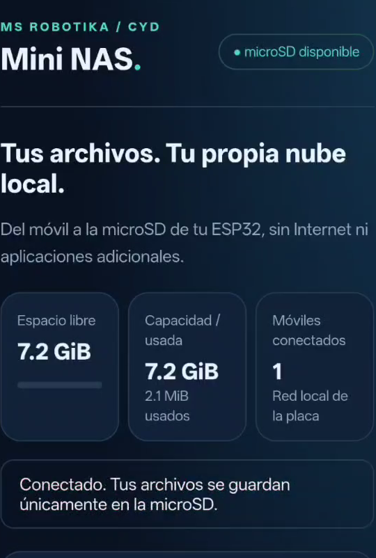

# Mini NAS CYD · MS Robotika

[← Catálogo de proyectos](../../README.md) · [Descargar ZIP](../../downloads/Mini-NAS-CYD.zip) · [Galería y evidencia](../../docs/MINI_NAS.md)



**Tu propia nube local en una pantalla ESP32.** Conecta el móvil a la Wi-Fi de la placa y guarda fotos, documentos o proyectos en su microSD desde el navegador. Funciona sin Internet ni servicios externos.

**Estado: acceso QR confirmado por el autor y fallo intermitente de escritura diagnosticado en su tarjeta. La SD pasa a 1 MHz: a 4 MHz se reprodujo un error de E/S con espacio libre; a 1 MHz las dos variantes de escritura y lectura completaron sus archivos de prueba. El autor confirmó después que la subida desde el móvil guarda el archivo y aparece en el listado.** Consulta [reparación y verificación SD](.specify/bugs/sd-upload/test.md), [verificación QR anterior](specs/002-qr-access/verification.md) y [transferencias iniciales desde PC](specs/001-mini-nas/verification.md). Cada informe identifica el binario y el alcance de su ensayo.

## Qué incluye

- Web adaptada al móvil, sin CDN, con lista de archivos paginada y búsqueda en la página.
- Subida secuencial de varios archivos con progreso y cancelación; hasta **128 MiB por archivo**.
- Descarga, vista de JPEG/PNG/WebP y borrado individual con confirmación.
- Panel LCD con red, espacio libre/usado, clientes conectados y actividad.
- Botones táctiles **QR WIFI**, **QR WEB** y **ESTADO**. El panel de estado incluye **SD** y **CALIBRAR**. BOOT físico breve muestra QR WIFI; mantenlo 2 segundos y suéltalo para calibrar. Si falta calibración, un toque nuevo en la pantalla también la inicia.
- AP WPA2 con contraseña aleatoria por arranque, login web y token para cambios.

Es un servidor HTTP local de archivos para makers. La primera versión trabaja con una carpeta plana, un cliente/transferencia a la vez y un máximo de cuatro dispositivos asociados al AP. No implementa SMB, RAID, cuentas individuales ni acceso por Internet.

## Preparación en AB MakerIDE SUPER

1. Extrae el paquete y conserva el `.ino`, las cinco cabeceras y la carpeta `src` juntos. En el ZIP para Arduino el principal se llama `MiniNasCYD.ino` dentro de `MiniNasCYD/`.
2. Abre el principal en [AB MakerIDE SUPER](https://github.com/msrobotika/AB-MakerIDE-SUPER).
3. Perfil declarado: **ESP32-2432S028R original / ILI9341 240×320 / XPT2046**. FQBN `esp32:esp32:jczn_2432s028r`; núcleo Arduino ESP32 **3.3.12**. Bibliotecas Adafruit GFX **1.13.0**, ILI9341 **1.6.2**, BusIO **1.17.4**. WiFi, WebServer, SD, SPI y Preferences pertenecen al núcleo. No requiere XPT2046_Touchscreen: el controlador táctil usa SPI software para liberar el bus de SD.
4. Compila. Una carga sustituye el programa actual de tu placa; confirma el modelo/puerto y conserva tus fuentes antes de hacerla.
5. Con la alimentación desconectada, inserta una microSD **FAT32** preparada por ti. El firmware **no formatea** la tarjeta. No se ha certificado compatibilidad con capacidades/marcas concretas.

El autor autorizó expresamente cargarlo después de publicar la estación meteorológica: carga correcta en COM4 y programa NAS identificado por STATUS. No se borró toda la flash ni se formateó la microSD.

## Conectar el móvil por QR

1. Enciende la CYD: aparece **QR WIFI**. Escanéalo con la cámara y acepta conectarte al NAS aunque indique que no hay Internet. El código contiene la red y la clave de esta sesión.
2. En la pantalla toca **QR WEB** y escanea el segundo código: abre el panel y concede una sesión sin escribir usuario ni contraseña.
3. **ESTADO** vuelve al panel de almacenamiento. Desde ahí **QR WIFI** abre de nuevo los códigos. BOOT físico breve muestra QR WIFI; BOOT 2 segundos y soltar mantiene la recuperación de calibración.

El código web caduca a los cinco minutos y se consume al entrar. Para otro móvil o un escaneo repetido pulsa QR WEB de nuevo; las sesiones ya abiertas siguen funcionando hasta reiniciar. La clave WiFi sigue cambiando al arrancar. Los dos QR reales conceden acceso: no los publiques en capturas ni vídeos.

Alternativa manual: desde la red de la placa abre **http://192.168.4.1**; usuario **maker** y clave que aparece en ESTADO durante 90 segundos. No se registra por serial. La calibración y el montaje de SD conservan su funcionamiento anterior.

Nombres de 1 a 80 caracteres: letras sin tildes, números, guiones, puntos y espacios interiores; se rechazan rutas, nombres ocultos/reservados y puntos/espacios finales. Los archivos colocados manualmente fuera de esa carpeta o con nombres no admitidos no se ofrecen en la web.

## Conservación de datos

La subida escribe únicamente `/MSR_NAS/.upload.part`. Se valida el tamaño, se cierra y se renombra al nombre final tras recibir el cuerpo completo. Un nombre existente no se reemplaza. Las transferencias interrumpidas se retiran o quedan como temporal oculto propio, que se limpia en la siguiente subida. Esto reduce archivos parciales visibles; **FAT32 no ofrece transacciones ni garantiza recuperación ante un corte de alimentación**.

No extraigas la tarjeta durante operaciones. El botón SD intenta volver a montarla, sin formatear; para sustituirla, apaga la placa primero. El borrado web es permanente y afecta solo al archivo confirmado. La carpeta no contiene papelera.

El acceso HTTP utiliza sesión por QR o autenticación Basic alternativa dentro de la red local WPA2; no hay HTTPS ni aislamiento entre usuarios autorizados. El QR web usa un token de 128 bits, de un solo uso y cinco minutos de vigencia. El fragmento del enlace se retira antes de enviarlo por cabecera; la cookie de sesión es HttpOnly y SameSite=Strict, se conserva en RAM y se invalida al reiniciar. El formulario público de arranque no da acceso a la API. La API no devuelve la clave Wi-Fi y el programa no la escribe por serial. No expongas este servicio por Internet ni publiques la pantalla con la clave visible.

## Buses y pines

| Elemento | Pines / uso |
|---|---|
| LCD HSPI | SCK14, MISO12, MOSI13, CS15, DC2, BL21, RST−1 |
| microSD VSPI | SCK18, MISO19, MOSI23, CS5, 1 MHz |
| Táctil SPI software | CLK25, MISO39, MOSI32, CS33, IRQ36 |
| BOOT | GPIO0; no mantener pulsado al alimentar/reiniciar |

Referencia del perfil: [pines CYD](https://github.com/witnessmenow/ESP32-Cheap-Yellow-Display/blob/main/PINS.md). No confirma otras revisiones. Se consultaron [SD SPI de Espressif](https://github.com/espressif/arduino-esp32/blob/3.3.12/libraries/SD/examples/SD_Test/SD_Test.ino) y el WebServer del core 3.3.12. Las subidas utilizan su callback de cuerpo RAW; no se promete compatibilidad con cores anteriores.

## Desarrollo y comprobaciones

```text
python tools/generate_ui.py --check
node --test tests/web.test.cjs
python tools/build.py
```

`web/index.html` y `web/app.js` son la interfaz real. Tras editarlos ejecuta `python tools/generate_ui.py`. `nas_web.h` permite servirla desde flash sin copiar archivos a la SD. La compilación comprueba 47 aserciones C++ de reglas y una de geometría QR; los once tests JavaScript usan dobles de DOM/red y no ejecutan el ESP32. `tools/build.py` solo compila y no instala ni graba.

Después de una carga que tú autorices y con el PC conectado al AP, puedes ejecutar:

```text
python tests/device_contract.py
python tests/device_contract.py --write-tests
```

La primera orden solo consulta. La segunda crea archivos de prueba con nombres únicos, comprueba descarga/duplicado/interrupción y elimina únicamente su archivo completo de prueba; las pruebas de transferencia se ejecutaron en la CYD desde PC con resultado correcto y limpieza de sus archivos de ensayo. La contraseña se solicita sin eco y se mantiene en memoria. Completa también el [checklist físico](tests/HARDWARE.md).

## Licencia

Código propio [MIT](LICENSE). Arduino ESP32 y las bibliotecas conservan sus licencias; consulta [atribuciones](THIRD_PARTY_NOTICES.md). No se incluyen firmware compilado ni datos privados. El pequeño encoder QR de ricmoo 0.0.1 se distribuye bajo MIT con sus avisos y procedencia en `src/ricmoo`; no requiere instalar una biblioteca QR global.

## Recuperación de controles

Si se agotó la calibración inicial, toca y suelta la pantalla para volver a las cruces. También puedes mantener BOOT físico 2 segundos y soltarlo. Toca cada cruz y levanta el dedo antes de la siguiente. Por USB a 115200, STATUS informa estado sin claves; SHOWKEY habilita la clave en el panel ESTADO, y CALIBRATE abre las cruces. Ninguno devuelve la contraseña por serial.

## Diagnóstico de escritura en microSD

La frecuencia de 1 MHz se eligió tras reproducir escrituras parciales con errno 5 a 4 MHz en la CYD/tarjeta del autor. Reduce velocidad para priorizar la comunicación comprobada; no garantiza todas las tarjetas ni alimentación. El error de escritura no significa necesariamente tarjeta llena. No se reintenta un bloque ignorando errores ni se ofrece el archivo parcial como completo.

Por USB, `SDTEST` crea dos archivos de ensayo con nombres aleatorios en MSR_NAS, escribe 262 161 bytes por variante, cierra, reabre y compara cada byte, y elimina solo esos archivos propios. Es una prueba que escribe en la tarjeta; úsala deliberadamente. `STATUS` informa contadores, tamaños de bloque y errno sin nombres personales ni claves. El ensayo de SD no sustituye una subida desde el navegador.


## Verificación del acceso QR

El QR se dibuja a 180×180 píxeles: versión 5, ECC medium, módulos de 4 píxeles y margen blanco de cuatro módulos. El código no desaparece por temporizador; el enlace web sí caduca. El encoder está aislado para evitar la colisión del qrcode.h incluido por el SDK.

`tests/qr_device_decode.py` pide por USB dos matrices con datos públicos de prueba y las decodifica con OpenCV. Requiere pyserial, numpy y opencv-python. No lee claves reales y no sustituye el ensayo de cámara sobre el LCD. [Evidencia QR](specs/002-qr-access/verification.md).
