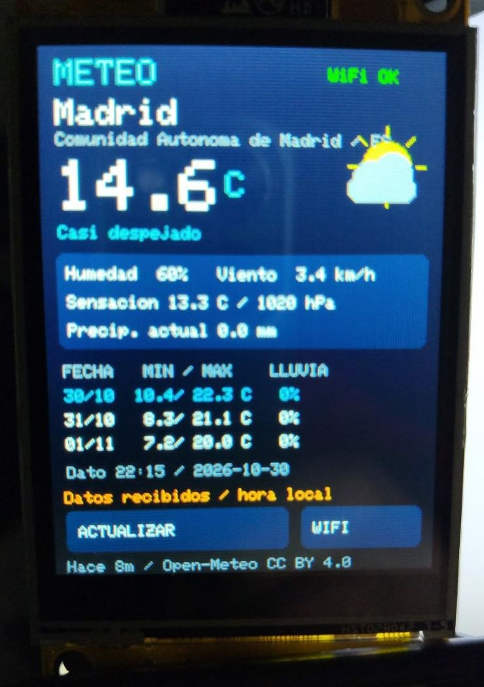

# Estación meteorológica WiFi CYD

[← Catálogo](../../README.md) · [AB MakerIDE SUPER](https://github.com/msrobotika/AB-MakerIDE-SUPER)

**[Descargar proyecto en ZIP](../../downloads/Estacion-Meteo-CYD.zip)** · [Galería real y límites](../../docs/WEATHER_STATION.md)

Firmware Arduino C++ para CYD **ESP32-2432S028R**, ILI9341 vertical 240×320 y táctil XPT2046. Consulta Open-Meteo por WiFi: temperatura, sensación, humedad, viento, presión y previsión de hoy y dos días siguientes. Son **datos de modelo por Internet**, no mediciones de sensores locales.



## Qué muestra la demostración

Las primeras tomas mostraban la configuración. **El nuevo vídeo y la fotografía sí muestran Madrid con WIFI OK y valores meteorológicos recibidos**, después de configurar la placa mediante su portal. Madrid es una ubicación de prueba, no una ubicación personal atribuida al autor. La exportación original `compiled_only` se conserva como histórica. No se afirma una prueba física exhaustiva ni una asociación demostrada entre el vídeo y el hash de un binario concreto. [Validación de esta incorporación](../../specs/003-weather-station/verification.md).

## Preparación

1. Extrae el ZIP y conserva `WeatherStationCYD.ino`, `weather_model.h` y `weather_ca.h` en la carpeta `WeatherStationCYD`. En el repositorio el principal mantiene su nombre original `sketch.ino`.
2. Abre el principal con AB MakerIDE SUPER y prepara el entorno descrito abajo.
3. Después de una carga que decidas realizar en tu propia placa, calibra las tres cruces. La configuración inicial muestra una red `MSR-Meteo-XXXX` y una contraseña aleatoria de sesión.
4. Conecta el móvil o PC a esa red y abre `http://192.168.4.1`. Introduce tu WiFi de **2,4 GHz**, ciudad y país opcional. La información persiste en NVS; no está incrustada en el código.

El AP cambia su contraseña tras reiniciar. No se activa cifrado de flash/NVS. No publiques fotografías del portal o la pantalla de configuración sin ocultar sus claves y los datos de tu red.

## Controles

- **ACTUALIZAR** o toque breve: solicita datos; mínimo 60 s entre intentos.
- **WIFI**, pulsación larga o BOOT mantenido 2 s: abre/cierra configuración.
- Actualización automática cada 15 min; reintento tras fallo cada 2 min. Lecturas de más de 30 min se marcan ANTIGUO.
- Si no hay datos se muestra configuración/estado, sin inventar lecturas. El proyecto no conserva meteorología tras un reinicio.

## Entorno y pines

FQBN: `esp32:esp32:jczn_2432s028r`. Arduino ESP32 **3.3.12**, Adafruit GFX **1.13.0**, ILI9341 **1.6.2**, BusIO **1.17.4**, XPT2046_Touchscreen **1.4**, ArduinoJson **7.4.2**, WiFiManager **2.0.17**. WiFi, HTTPClient, NetworkClientSecure, Preferences y FreeRTOS pertenecen al core.

| Elemento | GPIO |
|---|---|
| LCD HSPI | SCK14, MISO12, MOSI13, CS15, DC2, BL21, RST−1 |
| Táctil | SCK25, MISO39, MOSI32, CS33, IRQ36 |
| SD | CS5 alto; no se inicializa |
| BOOT | GPIO0 |

Perfil declarado, sin certificar compatibilidad con otras revisiones. [Referencia de pines](https://github.com/witnessmenow/ESP32-Cheap-Yellow-Display/blob/main/PINS.md).

Desde esta carpeta:

```text
python tools/build.py
python tests/test_api_contract.py
```

La utilidad solo compila; `--arduino-cli` permite indicar el ejecutable. Salidas en `.build/`, excluidas de Git. Las dos pruebas de API usan Sevilla como dato de prueba, validan HTTPS con la raíz pública del firmware y comprueban contrato/campos y localidad inexistente. No ejecutan el firmware, parser C++, radio ni pantalla. Se ha retirado del test distribuido únicamente la comprobación de backups privados del entorno original; no se marca como repetida.

## Datos, TLS y licencia

Código propio bajo [MIT](../../LICENSE). Datos Open-Meteo bajo CC BY 4.0, con atribución en pantalla. La API gratuita tiene condiciones de **uso no comercial**; revisa [las condiciones vigentes](https://open-meteo.com/en/terms) para tu uso, incluidas actividades promocionales. Publicar el código bajo MIT no cambia esas condiciones.

[API meteorológica](https://open-meteo.com/en/docs) · [Geocodificación](https://open-meteo.com/en/docs/geocoding-api) · [ISRG Root X1](https://letsencrypt.org/certificates/). `weather_ca.h` contiene un certificado raíz público, no una clave privada. Si cambia la cadena de confianza, actualiza la raíz; no desactives la validación HTTPS.

[README original con ruta personal ocultada](reference/README.original.redacted.md) · [Referencia original](MAKERIDE_HARDWARE_REFERENCE.txt) · [Exportación original](MAKERIDE_EXPORT.json). Sus afirmaciones y rutas históricas no sustituyen los resultados actuales.
